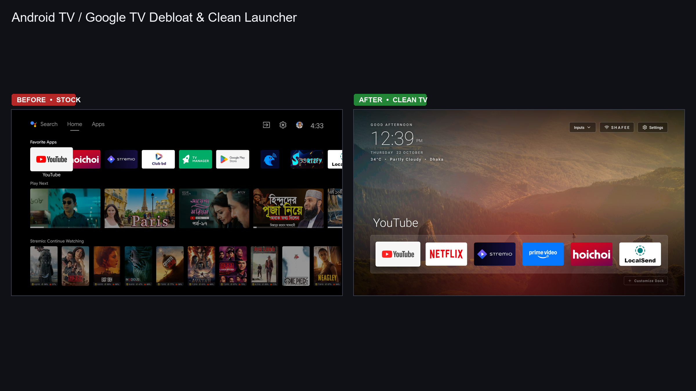
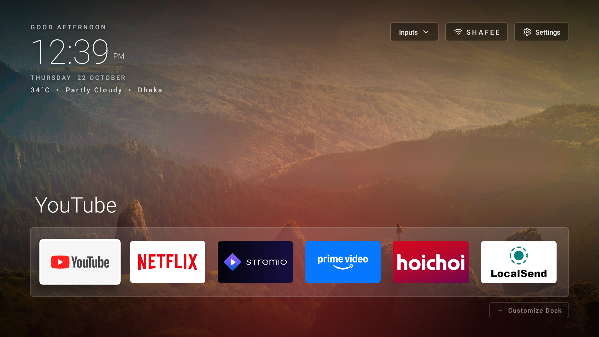
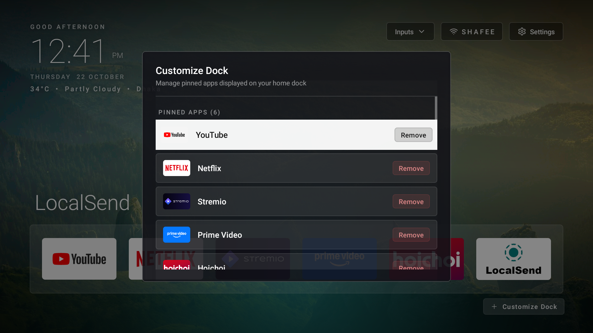

# tv-home

**Make a slow, ad-filled Android TV fast, clean, and beautiful again.**

Debloat it over Wi-Fi and replace the cluttered stock launcher with a tiny, lightning-fast Apple TV-style home screen featuring dynamic nature wallpapers, live weather, network status, an inputs switcher, and a custom dock of your favorite apps.

Everything is safe and 100% reversible: bloat packages are disabled for user 0, never permanently deleted.



---

## Features

- **Blazing Fast & Lightweight**: Zero background bloat, minimal memory footprint (replaces 200MB+ bloated OEM launchers with a native ~50KB home screen).
- **Apple TV-Style Experience**:
  - Live clock, greeting, date, and current weather top-left.
  - Status pills top-right: Wi-Fi network name, Ethernet status, Inputs dropdown (HDMI/AV/Live TV), and Settings shortcut.
  - Pinned dock for favorite apps with focused app title and banner glow.
  - D-pad Down opens full app drawer in a responsive grid.
  - Long-press / Menu key to customize dock apps directly from the TV.
- **Dynamic Nature Wallpapers**: Smoothly crossfades curated high-resolution landscape photography from Unsplash.
- **Zero ADB Binary Requirement**: Connects over Wi-Fi using pure Python `adb-shell` (no Android SDK ADB installation needed, avoids macOS Local Network blocking).
- **Cross-Platform**: First-class support for both **Windows** (PowerShell) and **macOS / Linux** (Bash).
- **Completely Reversible**: Back up package lists and restore stock launcher anytime.

---

## Quick Start

### 1. Enable USB Debugging on your TV

1. On the TV: Go to **Settings** → **Device Preferences** (or **System**) → **About**.
2. Click **Build** 7 times until Developer mode is enabled.
3. Go back to **Developer options** → turn on **USB debugging**.
4. Make sure your computer and TV are connected to the same Wi-Fi network.

### 2. Setup & Find TV

#### On Windows (PowerShell)

```powershell
# 1. One-time environment setup (creates venv and installs Python ADB tool)
.\setup.ps1

# 2. Discover TV on Wi-Fi and verify device details
.\tools\tv.ps1 --find
.\tools\tv.ps1 --probe

# 3. Debloat bloatware & telemetry (reversibly)
.\tools\tv.ps1 --disable .\examples\xiaomi-p1-croods\debloat.txt

# 4. Build and install launcher APK to TV
.\launcher\build-and-install.ps1
```

#### On macOS / Linux (Bash)

```bash
# 1. One-time setup
./setup.sh

# 2. Discover TV and verify connection
tools/tv.sh --find
tools/tv.sh --probe

# 3. Debloat bloatware & telemetry (reversibly)
tools/tv.sh --disable examples/tcl-google-tv-g07/debloat.txt

# 4. Build and install launcher APK to TV
launcher/build-and-install.sh
```

---

## TV Control CLI (`tools/tv.py`)

The unified CLI tool handles all device interactions across all operating systems:

```bash
# Discovery & Info
tools/tv.sh --find                      # Scan local subnet for TV & save IP
tools/tv.sh --probe                     # Show hardware model, brand, Android version, display
tools/tv.sh --backup backup.txt         # Backup list of currently installed packages

# Debloat & Restore
tools/tv.sh --disable debloat.txt       # Disable packages listed in debloat file
tools/tv.sh --restore debloat.txt       # Re-enable packages and restore stock launcher

# Productivity & Remote
tools/tv.sh --shot screenshot.png       # Capture high-res screenshot from TV
tools/tv.sh --type "search term" --enter # Type text directly into TV input fields
tools/tv.sh "pm list packages -3"       # Run any arbitrary ADB shell command
```

*(On Windows, replace `tools/tv.sh` with `.\tools\tv.ps1`)*.

---

## Repository Structure

| Path | Description |
| --- | --- |
| [setup.ps1](setup.ps1) / [setup.sh](setup.sh) | One-time environment setup for Windows and macOS/Linux |
| [launcher/](launcher/) | Lightweight native Android TV launcher source code |
| [launcher/res/values/config.xml](launcher/res/values/config.xml) | Configure default dock apps, hidden system packages, and grid layout |
| [launcher/build-and-install.ps1](launcher/build-and-install.ps1) | Build APK and install directly to TV (Windows) |
| [launcher/build-and-install.sh](launcher/build-and-install.sh) | Build APK and install directly to TV (macOS/Linux) |
| [tools/tv.py](tools/tv.py) | Pure-Python ADB client: Wi-Fi discovery, debloat, restore, typing, screenshots |
| [tools/tv.ps1](tools/tv.ps1) / [tools/tv.sh](tools/tv.sh) | Convenient CLI wrappers for Windows PowerShell and Bash |
| [examples/](examples/) | Community debloat lists per TV model (Xiaomi, TCL, etc.) |
| [docs/screenshots/](docs/screenshots/) | High-resolution screenshots of clean launcher and menus |

---

## Screenshots

| Clean Home Screen | Inputs & TV Tuner Switcher |
| :---: | :---: |
|  |  |

---

## Tested & Supported TVs

- **Fully Tested & Verified**: **Xiaomi P1 (43" 4K Google Android TV — MiTV-MOOQ0 / croods / Android 10)**.
- Compatible with all Android TV & Google TV devices (Android 9+):
  - **Xiaomi / Redmi TV** (P1, 4K, 5A, PatchWall sets)
  - **TCL Google TV & Android TV**
  - **Sony Bravia** (Android TV / Google TV)
  - **Hisense** (Android TV / Google TV)
  - **Chromecast with Google TV**
  - **Nvidia Shield TV**
  - **OnePlus TV, Realme TV, Vu, etc.**

*(Note: Samsung Tizen, LG webOS, and Amazon Fire OS are not Android TV sets).*

---

## Gotchas & Troubleshooting

- **Google TV / Android TV Home Button Hijacking**: When disabling stock launchers, Google's setup wizard (`com.google.android.tungsten.setupwraith`) can intercept the Home button. The install script automatically disables this package, and restore re-enables it.
- **Location Permission for Wi-Fi Name**: On Android 10+, Android hides Wi-Fi SSID from apps unless granted location permissions (`ACCESS_FINE_LOCATION`). The build-and-install scripts grant this via ADB automatically.
- **Reversible Changes**: No system partition modifications are performed. All disabled apps can be re-enabled instantly with `--restore`.

---

## Authors & Credits

- **Author (This Enhanced Version)**:
  - **Abu Sayeed Bin Farhad Shafee / Lilac E Designs LLC**
  - Complete overhaul, Windows PowerShell and cross-platform Python CLI tools, dynamic Unsplash nature wallpapers, weather, custom dock management, Xiaomi P1 optimization, and standalone build pipelines.
- **Original Foundation**:
  - Based on the initial launcher concept and scripts by **Mihir Gupta** ([mihirgupta0900/tv-home](https://github.com/mihirgupta0900/tv-home)), inspired by [tv-vibehack](https://github.com/Gathin23/tv-vibehack) by Gathin23.
- **Photography**:
  - Wallpaper photography dynamically sourced from [Unsplash](https://unsplash.com) creators under the Unsplash License (see [launcher/WALLPAPER-CREDITS.md](launcher/WALLPAPER-CREDITS.md)).
- **License**:
  - Released under the [MIT License](LICENSE).
